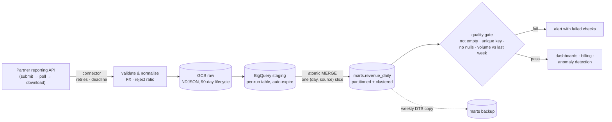

# GCP data platform template

[](https://github.com/thanzap/gcp-data-platform-template/actions/workflows/ci.yml)


A production-shaped template for ingesting third-party reporting APIs into BigQuery with Cloud Composer
(Airflow), distilled from 4+ years of building and operating production pipelines for a programmatic advertising
network. It's written from scratch against a fictional API, so no employer code is included; the patterns are the
ones that kept those pipelines reliable.



## What's in it

| Path | What | Why it matters |
|---|---|---|
| [`pipelines/connectors/base.py`](pipelines/connectors/base.py) | Base class for async-report APIs | Hard deadline on polling, per-call timeouts required, retries only for 408/429/5xx/network, `Retry-After` honoured, 4xx fails fast |
| [`pipelines/connectors/example_ssp.py`](pipelines/connectors/example_ssp.py) | A concrete connector in ~40 lines | New sources only implement `submit` / `status` / `download`; pagination has a hard cap |
| [`pipelines/transform.py`](pipelines/transform.py) | Validation and normalisation | `Decimal` money and FX to EUR, cleaned domains; bad rows collected with reasons; a format change upstream (reject ratio > 1 %) **stops the load** instead of loading garbage |
| [`pipelines/bigquery.py`](pipelines/bigquery.py) | GCS → staging → `MERGE` | Idempotent: re-running a day replaces exactly that (day, source) slice in one atomic statement, with partition pruning on the target |
| [`pipelines/quality.py`](pipelines/quality.py) | Post-load quality gate | Catches the "succeeded with 10 % of the rows" partial export; the alert lists *which* checks failed |
| [`dags/ssp_revenue_daily.py`](dags/ssp_revenue_daily.py) | Airflow 3 TaskFlow DAG | Thin orchestration over the library; heavy imports inside tasks for fast parsing; a timeout on every task; secrets from Secret Manager |
| [`terraform/`](terraform/) | Infrastructure | Buckets with lifecycle rules, datasets, a partitioned table with `require_partition_filter`, least-privilege SAs (dataset-level, not project-wide), secret containers (values never in state), **weekly BigQuery backups via Data Transfer Service** |
| [`.github/workflows/ci.yml`](.github/workflows/ci.yml) | CI/CD | ruff + pytest, DAG integrity on real Airflow 3.1, `terraform validate`, then DAG deploy to Composer via **Workload Identity Federation** (no keys in GitHub) |

## Failure modes covered by tests

| Failure mode | Guard |
|---|---|
| A report stuck in "running" holds a worker slot indefinitely | `test_stuck_report_hits_the_deadline_instead_of_hanging`; the connector also refuses an `httpx.Client` without a read timeout |
| An expired credential is retried for half an hour before anyone notices | `test_client_errors_fail_immediately_without_retry` |
| The partner renames a field and the load quietly writes empty values | `test_format_change_upstream_stops_the_load` |
| A backfill or retry duplicates revenue | `test_merge_is_scoped_to_one_day_and_source` |
| A partial export "succeeds" and dashboards show a fake revenue collapse | the `volume_vs_last_week` quality check |
| A new DAG ships without retries, owner or timeout | `test_dag_integrity.py` enforces them on every task of every DAG |

## Run it

```bash
uv sync
uv run pytest -q                                        # library tests (no GCP needed)
uv sync --python 3.12 --group airflow
uv run --group airflow pytest -q tests/test_dag_integrity.py

cd terraform
terraform init && terraform plan -var-file=example.tfvars
terraform output airflow_variables                      # → Airflow Variables in Composer
```

Adding a source: subclass `AsyncReportConnector`, add a schema mapping in `transform.py` if the fields differ,
and copy the DAG. Loading, quality gates, alerting and deployment stay the same.

---

Built by **Thanasis Zapatetas** · MIT licensed
